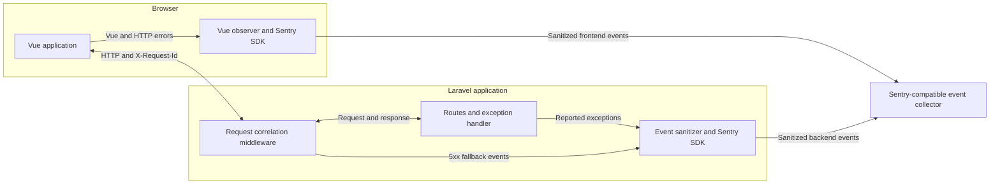
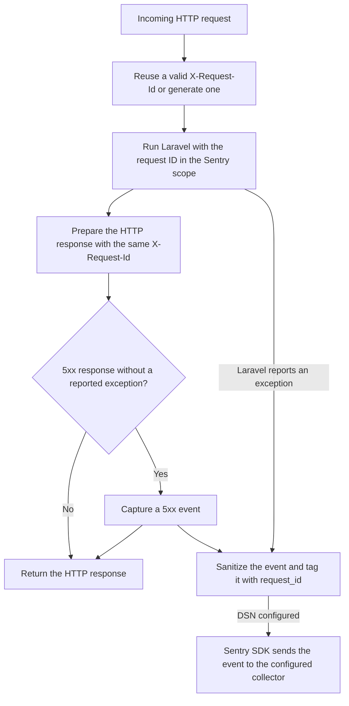

# Laravel Observability

`event-observability/laravel` reports Laravel errors to a Sentry-compatible
collector using the official SDK. It correlates requests and errors with
`X-Request-Id` and limits the event data sent to the collector.

Install the Laravel package for backend errors, the [Vue package](vue/README.md) for
browser errors, or both to correlate a failure across the HTTP response. The
browser package supports native Fetch, Axios, VueUse, and private sourcemaps with Rollup or Vite.

## Architecture



The response carries `X-Request-Id`. When a browser adapter can read it, related
frontend and backend events can be matched in the configured collector using the `request_id` tag.

## Requirements

| Laravel | Minimum PHP |
| --- | --- |
| 12.71+ within 12.x | 8.2 |
| 13.40+ within 13.x | 8.3 |

These minimum versions include upstream security fixes. Applications on Laravel 11
need to upgrade before installing this revision. The package requires PHP's
`mbstring` extension and Sentry's Laravel SDK 4.28 or later within the 4.x series.

## Installation

To try the current checkout from a Laravel application, register its local path
and require the development branch. Composer links the checkout when the
filesystem supports symlinks.

```sh
composer config repositories.observability-local path /absolute/path/to/observabilidad
composer require event-observability/laravel:dev-main
```

For the downloadable ZIP, extract it to a stable directory and use that
directory as the local Composer path above. This also works on shared hosting.
Laravel sends HTTP error reports during the request. The package requires no
queue worker, jobs table, Redis, or cron. Its queue listener runs when the
host application processes a job.

For installations from a private Composer registry that hosts version 0.2.0,
set `COMPOSER_REGISTRY_URL` to the registry endpoint and run these commands
from the Laravel application directory.

```sh
composer config repositories.observability-packages composer "$COMPOSER_REGISTRY_URL"
composer require event-observability/laravel:^0.2.0
```

Serve versioned release archives from stable registry URLs so existing
installations can still resolve and download them if the source code moves.

Laravel discovers the service provider and registers the request middleware automatically.
Register Sentry's exception handler once in the application's `bootstrap/app.php`.

```php
use Illuminate\Foundation\Configuration\Exceptions;
use Sentry\Laravel\Integration;

// Inside the Application::configure(...) chain:
->withExceptions(function (Exceptions $exceptions): void {
    Integration::handles($exceptions);
})
```

When migrating an existing application, remove its previous 5xx reporting middleware
and migrate any custom Sentry settings that refer to its old integration classes.
Keep a single call to `Integration::handles()`.

## Configuration

Set the application name, DSN, environment, and release in the Laravel application's environment.

```dotenv
OBSERVER_APPLICATION=my-app-backend
OBSERVER_DSN=
SENTRY_ENVIRONMENT=staging
SENTRY_RELEASE=my-app-backend@deployment-id
SENTRY_HTTP_CONNECT_TIMEOUT=1
SENTRY_HTTP_TIMEOUT=2
```

`OBSERVER_DSN` takes precedence over `SENTRY_LARAVEL_DSN` and `SENTRY_DSN`.
An explicitly empty value disables reporting. An invalid DSN disables delivery
and makes `observability:diagnose` exit with an error without printing the DSN.
Use an HTTPS DSN with a public project key. The standard transport verifies
the collector's TLS certificate. HTTP is supported on loopback for local testing.
Passwords, query strings and fragments make the DSN invalid.
`APP_ENV` is the fallback environment.

To customize the package configuration in PHP, publish
`config/observability.php`. Rebuild the configuration cache after changing
settings in an application that uses cached configuration.

```sh
php artisan vendor:publish --tag=observability-config
php artisan config:cache
php artisan observability:diagnose
```

The diagnostic command checks configuration without printing credentials or
sending an event. Run `php artisan observability:diagnose --send` to send a fixed
synthetic event through the configured transport. It exits successfully when
the transport accepts the event and flushes successfully, and prints the event ID
for lookup in the collector. A rejected send produces a nonzero exit code.

### Privacy settings by deployment

Configure each application and environment independently. Choose the event
and breadcrumb text settings separately so a deployment can send exception
messages while omitting logs and action descriptions.
For a deployment with both Laravel and Vue, configure each SDK with its
own policy and DSN. For a deployment with only one runtime, configure that
package alone.

| Laravel environment variable | Vue `privacy` option | Values and default |
| --- | --- | --- |
| `OBSERVER_EVENT_TEXT` | `eventText` | `omit` (default), `redact`, `full` |
| `OBSERVER_BREADCRUMB_TEXT` | `breadcrumbText` | `omit` (default), `redact`, `full` |
| `OBSERVER_URLS` | `urls` | `omit` (default), `redact` |
| `OBSERVER_CAPTURE_USER_ID` | `captureUserId` | `false` (default), `true` |

- `omit` keeps diagnostic structure such as exception type, stack locations,
  HTTP status, request correlation, and breadcrumb categories. It replaces
  captured free-text messages with placeholders or omits the text field.
- `redact` masks recognized patterns. Free text and URL path segments can
  still contain personal data. URL redaction strips credentials, query strings,
  and fragments from the URL fields it handles.
- `full` sends the text of the selected field as captured. It can include
  personal data, secrets, or URLs embedded in that text. Enable it only for
  deployments where the collector is authorized to receive that data.
- User ID capture adds the internal ID. Evaluate that ID according to the
  application's data policy. Vue also accepts a `getUserId` callback when
  user ID capture is enabled.

For example, a deployment with restricted collector access can enable full
exception text and keep breadcrumb text and IDs omitted.

```dotenv
OBSERVER_EVENT_TEXT=full
OBSERVER_BREADCRUMB_TEXT=omit
OBSERVER_URLS=omit
OBSERVER_CAPTURE_USER_ID=false
```

Keep the defaults for deployments that only need structured diagnostics. For
development or staging, choose `redact` for the text and URL fields that
developers need. Existing Laravel apps with a published `capture_user_id`
setting can change it directly or replace it with the environment-backed
setting from the current configuration.

## Reporting and privacy

### Request correlation and error reporting



- The global middleware reuses a request ID of 1–64 alphanumeric or hyphen
  characters or generates a random, 32-character hexadecimal ID. It returns the
  ID in `X-Request-Id`, including on error responses, and tags events with
  `request_id`. For cross-origin requests, allow and expose this header in the
  application's CORS settings. Request IDs are public correlation labels. Use a
  generated opaque value and keep authorization decisions independent of it.
- Laravel handles exception reporting. A 5xx response without a reported
  exception generates an event grouped by method, route template, and status.
  A 4xx response alone does not generate an event. To report a caught exception
  that returns a successful or 4xx response, call `report($exception)`.
- Each HTTP request and queue job has its own SDK scope. Nested synchronous
  jobs restore their parent's context on return. Worker failures keep their job
  context while Laravel reports the exception.
- Events include the `application` tag, environment, release, approved
  breadcrumbs, stack frame locations, and optionally an internal user ID.
  The event allowlist removes HTTP body and header fields, cookies, source
  snippets, frame variables, and unrelated context in every privacy mode.
- Reporting is synchronous with configurable connection and request timeouts.
  Invalid timeouts and values below one millisecond use the defaults of one
  second to connect and two seconds total. Transport failures preserve the
  application's response. SDK diagnostics go to the local PHP error log
  without event payloads.
- The integration disables tracing, profiling, structured logs, metrics, and
  Spotlight. Outgoing Laravel HTTP requests omit Sentry trace and baggage
  headers. SDK features explicitly called by the host application, such as
  cron check-ins, have their own data contract.

## Development

Run these commands from the directory containing `composer.json`.

```sh
composer validate --strict
composer install
composer test
composer audit
```

The library resolves dependencies for the current PHP version. To test
Laravel 13 explicitly on PHP 8.3 or later, run
`composer update --with 'laravel/framework:^13.40'` in a separate working copy.
The test suite boots a minimal Laravel application with an in-memory transport.

To run the suite against an existing Laravel installation that already includes
the Sentry SDK dependencies, set `OBSERVER_TEST_AUTOLOAD` to its autoloader.

```sh
OBSERVER_TEST_AUTOLOAD=/path/to/app/vendor/autoload.php \
  php /path/to/phpunit.phar -c phpunit.xml.dist
```

Composer distribution archives exclude development files and the Vue package.
Consuming applications manage their own dependency locks.

```sh
composer archive --format=zip --dir=/path/to/archives
```
